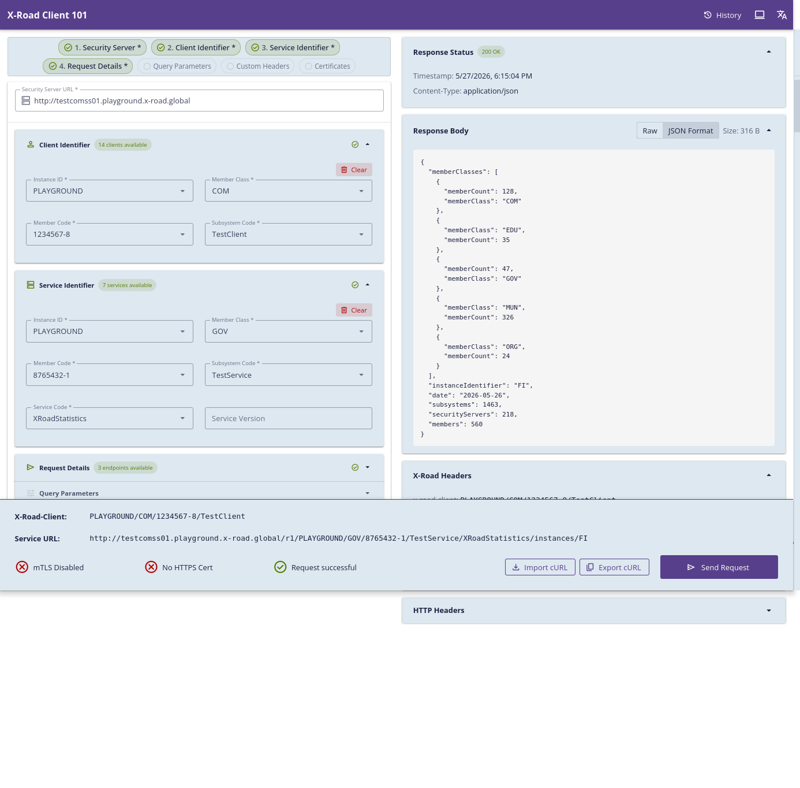
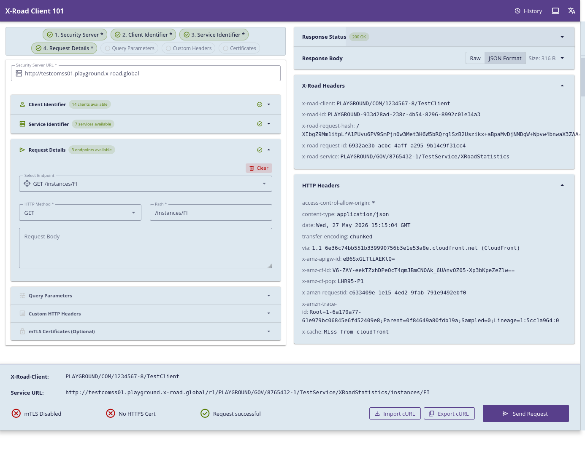
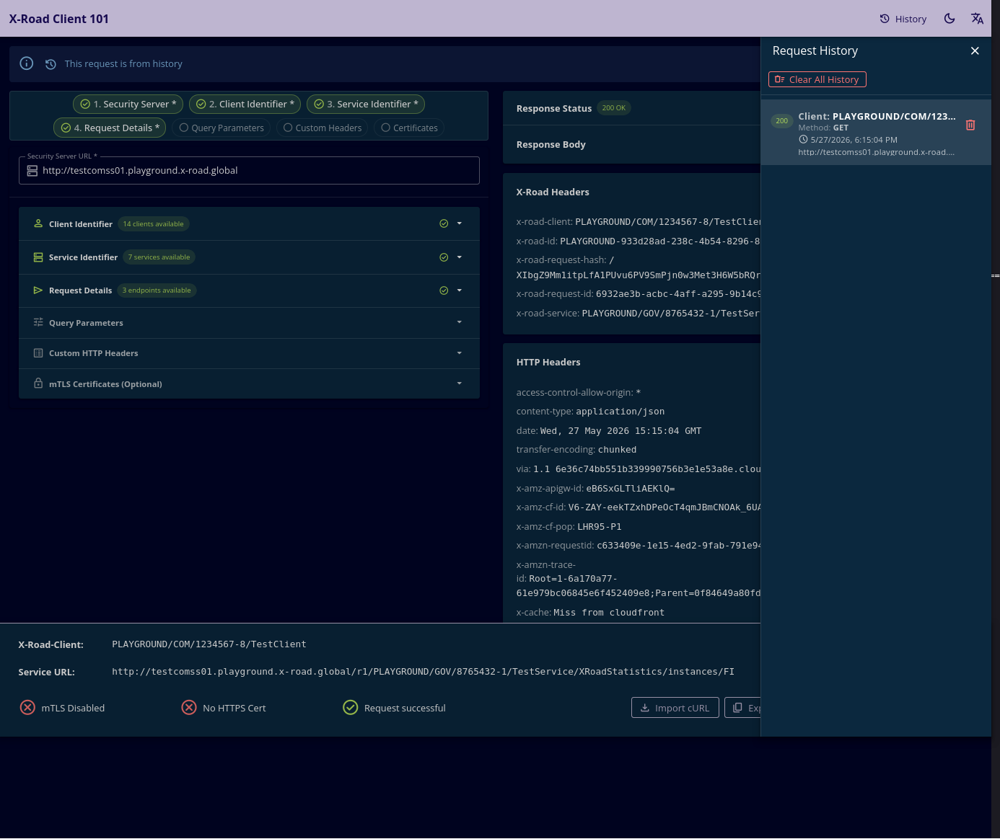

# X-Road Client 101

A learning tool for developers new to X-Road. See how client and service identifiers map to X-Road headers and service URLs, send test requests, and inspect responses.

## Quick Start

**Docker:**

```bash
docker run -p 8080:8080 ghcr.io/melbeltagy/x-road-client-101:latest
```

**From source:**

```bash
./gradlew
```

Open <http://localhost:8080>

## Docker

See [docker/README.md](docker/README.md) for full Docker documentation including:

- Docker Compose setup
- Connecting to a local Security Server
- Configuration options
- Building locally
- Available tags

## Configuration

Edit `src/main/resources/application.yml`:

```yaml
application:
  xroad:
    timeout:
      connect-ms: 60000
      read-ms: 120000
  frontend:
    max-history-entries: 15
```

For Docker configuration, see [docker/README.md](docker/README.md#configuration).

## Screenshots

### Client and service identifiers



### Request configuration and response viewer



### Dark theme and request history



## Contributing

See [CONTRIBUTING.md](CONTRIBUTING.md) for dev setup, build and test commands, commit conventions, pre-commit hooks, and PR process.

## License

Licensed under the MIT License. See [LICENSE](LICENSE).
